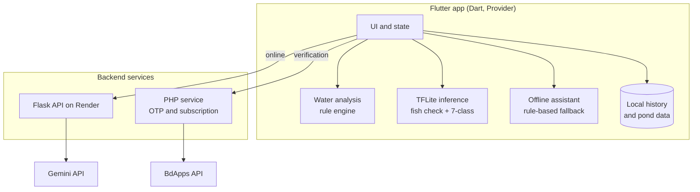

# AquaGuard AI

**A mobile assistant that helps fish farmers in Bangladesh detect pond and fish health problems earlier.**


AquaGuard AI combines **water-quality analysis, on-device fish image screening, a Bangla AI assistant and pond record-keeping** in one Flutter app. Core features work **offline**, which matters for rural ponds with weak connectivity.

> **Important notice.** AquaGuard AI provides **advisory and screening information only. It is not a veterinary diagnosis.** Image results come from models tested on public datasets, not field trials. Water-quality ranges are advisory and need expert review. Always consult a qualified fish health professional or local fisheries office before treating fish or changing pond management.

---

## Table of contents

1. [Why this project](#1-why-this-project)
2. [Feature overview](#2-feature-overview)
3. [Feature details](#3-feature-details)
4. [AI components](#4-ai-components)
5. [System architecture](#5-system-architecture)
6. [Tech stack](#6-tech-stack)
7. [Offline behaviour](#7-offline-behaviour)
8. [Project structure](#8-project-structure)
9. [Getting started](#9-getting-started)
10. [Configuration and secrets](#10-configuration-and-secrets)
11. [Image models: details and results](#11-image-models-details-and-results)
12. [Datasets](#12-datasets)
13. [Limitations and risks](#13-limitations-and-risks)
14. [Roadmap](#14-roadmap)
15. [Contributing and feedback](#15-contributing-and-feedback)
16. [References](#16-references)
17. [License](#17-license)

---

## 1. Why this project

Bangladesh produced about **5.11 million tonnes of fish in 2024-25**. Too often, farmers learn about a problem in the pond only after fish are already lost.

| Context | Figure | Source |
|---|---|---|
| Fisheries share of GDP | about 2.6% | [4] |
| People involved in fisheries | roughly 20.6 million | [4] |
| August 2024 floods | estimated Tk 1,899 crore fisheries loss; 197,166 ponds and hatcheries damaged in 13 districts | [1] |
| July 2026, Chattogram | preliminary Tk 91.42 crore loss; fish washed away from 9,933 ponds, lakes and farms | [2] |

A 2025 study of 400 finfish farmers in six districts (*Aquaculture International*, surveyed 2022) reported [3]:

- **92%** named water-quality deterioration a major problem
- **87%** named disease outbreaks a major problem
- about **70%** had experienced disease within two years
- only about **26%** could identify disease from symptoms

Problems are noticed late, and decisions often lack records or quick access to experts. AquaGuard AI is built to close part of that gap.

---

## 2. Feature overview

| Module | What it does | Works offline |
|---|---|:---:|
| Water analysis | Evaluates 9 pond water readings with rule-based feedback, risk level, trends and recommended actions | Yes |
| Fish image screening | Two on-device TFLite models check for a fish, then screen for seven categories, with signs and next steps | Yes |
| Bangla AI assistant | Answers pond questions by text or voice using the farmer's own readings | Partial (local rule-based fallback) |
| Pond health score | Summarises overall pond condition in a single score | Yes |
| Daily feed estimate | Suggests daily feed amounts | Yes |
| Growth charts | Weekly growth tracking with charts | Yes |
| History timeline | Chronological record of readings, screenings and actions | Yes |
| Account and subscription | OTP verification and subscription through BdApps API | No |

---

## 3. Feature details

### 3.1 Water-quality analysis

- Input of **9 water readings** per check (list the parameters here, for example temperature, pH, dissolved oxygen, ammonia, and so on)
- **Rule-based** evaluation against advisory ranges derived from WorldFish guidance [5]
- Output: per-parameter status, an overall **risk level**, **trends** across checks, and **recommended actions**
- Rule-based by design, so results are transparent, explainable and available offline

### 3.2 Fish image screening (on-device)

```
Fish photo → Fish validation → Disease classification → Screening result and next steps
```

1. **Fish vs. Not-Fish** model rejects images that do not contain a fish.
2. **7-class classifier** screens the image into one of:
   - Bacterial Red Disease
   - Bacterial Diseases – Aeromoniasis
   - Bacterial Gill Disease
   - Fungal Disease – Saprolegniasis
   - Parasitic Diseases
   - Viral Disease – White Tail Disease
   - Healthy Fish
3. The app shows the screening category with **observable signs and suggested next steps**, framed as screening rather than diagnosis.

Runs entirely on the phone through TensorFlow Lite, so it works without internet.

### 3.3 Bangla AI assistant

- Ask pond-related questions by **text or voice** in Bangla
- Powered by the **Gemini API**, using the farmer's **pond readings as context**
- **20+ ready-made questions** for quick use
- **Offline fallback:** a local rule-based assistant answers common questions when no connection is available

### 3.4 Pond management tools

- **Pond health score:** a combined indicator of pond condition (describe the inputs and formula here)
- **Daily feed estimates:** guidance for feed quantity (describe the inputs here)
- **Weekly growth charts:** track fish growth over time
- **History timeline:** a record of readings, screenings and actions, supporting better decisions and expert conversations

### 3.5 Verification and subscription

- **OTP verification** and **subscription** handled through a **PHP service integrated with the BdApps API**

---

## 4. AI components

| Component | Type | Runs | Purpose |
|---|---|---|---|
| Fish vs. Not-Fish | EfficientNetB0 (TFLite) | On-device | Validate that a photo contains a fish |
| Fish disease classifier | EfficientNetB0, 7 classes (TFLite) | On-device | Screen fish images for possible health issues |
| Bangla assistant | LLM (Gemini API) | Cloud, with local rule-based fallback | Answer pond questions in Bangla |
| Water analysis | Rule-based engine | On-device | Transparent, explainable water-quality feedback |

---

## 5. System architecture



Adjust the diagram to match your exact request flow (for example whether the app calls Gemini directly or through the Flask backend).

---

## 6. Tech stack

| Layer | Technology |
|---|---|
| Mobile app | Flutter, Dart, Provider (state management) |
| On-device AI | TensorFlow Lite |
| Model training | TensorFlow, Keras (EfficientNetB0, transfer learning) |
| LLM | Gemini API |
| Backend | Flask, hosted on Render |
| Verification and subscription | PHP, BdApps API (OTP, subscription) |

---

## 7. Offline behaviour

| Capability | Offline | Notes |
|---|:---:|---|
| Water analysis | Yes | Local rule engine |
| Fish image screening | Yes | Both TFLite models bundled in the app |
| Pond health score, feed estimate, growth charts, history | Yes | Stored locally |
| Bangla assistant | Partial | Local rule-based fallback; full LLM answers need internet |
| OTP and subscription | No | Requires network |

---

## 8. Project structure

> Adjust to match your actual repository.

```text
.
├── app/                      # Flutter application
│   ├── lib/
│   │   ├── models/
│   │   ├── providers/        # Provider state management
│   │   ├── screens/
│   │   ├── services/         # water rules, TFLite, assistant, API clients
│   │   └── widgets/
│   ├── assets/
│   │   ├── models/           # fish_not_fish.tflite, fish_disease.tflite
│   │   └── labels/
│   └── pubspec.yaml
├── backend/
│   ├── flask_api/            # Flask service (Render)
│   └── php_service/          # OTP and subscription (BdApps)
├── ml/
│   ├── notebooks/            # training and evaluation
│   └── models/               # .keras and .tflite
├── docs/                     # screenshots, diagrams, benchmarks
└── README.md
```

---

## 9. Getting started

### Prerequisites

- Flutter SDK and Dart
- Python 3.x (Flask backend and ML notebooks)
- PHP environment (verification service)
- Gemini API key
- BdApps credentials (for OTP and subscription)

### Run the app

```bash
git clone https://github.com/<username>/<repository>.git
cd <repository>/app
flutter pub get
flutter run
```

### Run the Flask backend

```bash
cd backend/flask_api
python -m venv .venv && source .venv/bin/activate   # Windows: .venv\Scripts\activate
pip install -r requirements.txt
flask run
```

### Reproduce the ML models

```bash
cd ml
pip install -r requirements.txt
# open the notebooks in notebooks/ (GPU recommended, e.g. Colab or Kaggle)
```

---

## 10. Configuration and secrets

**Never commit API keys, tokens or credentials.** Use environment variables or an untracked config file.

| Secret | Used by |
|---|---|
| `GEMINI_API_KEY` | Bangla assistant (backend or app, per your design) |
| BdApps credentials | PHP verification and subscription service |
| Backend base URL | Flutter app |

Add a `.env.example` listing variable names without values, and include `.env` in `.gitignore`.

---

## 11. Image models: details and results

### 11.1 Fish vs. Not-Fish (binary)

| Item | Detail |
|---|---|
| Architecture | EfficientNetB0, transfer learning |
| Data | 12,090 images: 6,045 fish and 6,045 non-fish |
| Non-fish sources | TensorFlow Flowers (3,670), CIFAR-10 (2,375) |
| Test set | 1,814 images |
| Test accuracy | about 99% |

**Caution.** This number likely overstates real-world performance. Flowers and low-resolution CIFAR-10 images are far easier than real ponds, nets, hands and murky water.

### 11.2 Fish disease classifier (7 classes)

| Item | Detail |
|---|---|
| Architecture | EfficientNetB0, transfer learning |
| Input | 224 × 224 × 3 (RGB) |
| Data | 5,257 images: 3,690 train / 795 validation / 772 test |
| Imbalance handling | Class weighting |
| Augmentation | Flip, rotation, zoom, contrast, brightness |
| Test accuracy | 98.70% (772 images) |

**Training**

| Stage | Trainable | Notes |
|---|---|---|
| 1 | New classification head | Backbone frozen |
| 2 | Last 80 backbone layers | Low learning rate fine-tuning |

Dropout, early stopping and learning-rate reduction were used.

### 11.3 Metrics still to be reported

| Item | Status |
|---|---|
| Per-class precision, recall, F1 and confusion matrix | Not yet reported |
| TFLite model size, latency, post-conversion accuracy | Not yet reported |
| Evaluation on realistic hard negatives | Not yet reported |

All results come from **public-dataset testing, not field trials**.

---

## 12. Datasets

| Dataset | Role | Link |
|---|---|---|
| MatsyaDx-BD | Fish disease images | https://lnkd.in/gHacX3-7 |
| Fish Disease Detection Dataset (irfanulhuda) | Fish disease images | https://lnkd.in/g895nKNQ |
| TensorFlow Flowers | Non-fish negatives | https://lnkd.in/gnf9CQmJ |
| CIFAR-10 | Non-fish negatives | https://lnkd.in/gTk-RSd9 |

Datasets are not redistributed here. Please follow each dataset's original license.

---

## 13. Limitations and risks

- **Not a diagnosis.** Image output is screening only and some conditions look alike in photos.
- **Public data only.** No field trials have been done yet.
- **Closed-set classifier.** The 7-class model picks one class even for unseen diseases, other species or poor photos.
- **Optimistic validator score.** Easy negatives overstate fish-check accuracy.
- **Possible dataset shortcuts.** Models may learn background or dataset style, and near-duplicate images across splits can inflate accuracy.
- **Advisory water ranges.** Ranges need expert review and may vary by species, region and season.
- **LLM answers.** Generated responses can be wrong or incomplete and should not replace expert advice.
- **Connectivity.** Full assistant answers, OTP and subscription require internet.

---

## 14. Roadmap

- [ ] Per-class metrics and confusion matrix for the 7-class model
- [ ] Realistic hard negatives for the fish check
- [ ] "Uncertain, consult an expert" outcome using confidence thresholds
- [ ] TFLite size, latency and post-conversion accuracy benchmarks
- [ ] Expert review of water ranges, class definitions and recommendations
- [ ] Field testing with farmers
- [ ] Flood-risk alerts

---

## 15. Contributing and feedback

Feedback is especially welcome from **fish pathologists, aquaculture specialists, ML engineers and farmers**. Please open an issue for bugs, incorrect guidance or suggestions, or submit a pull request.

---

## 16. References

1. ICSF: https://icsf.net/?p=125026
2. https://lnkd.in/g-punQUP
3. https://lnkd.in/gD7hXdqZ
4. The Observer BD: https://observerbd.com/news/588253
5. WorldFish: https://lnkd.in/g53DSDDf and https://lnkd.in/giCmkUsz

---

## 17. License

Add your chosen license here (for example MIT or Apache-2.0). Datasets remain under their original licenses, and model weights trained on third-party data may inherit their usage terms.
