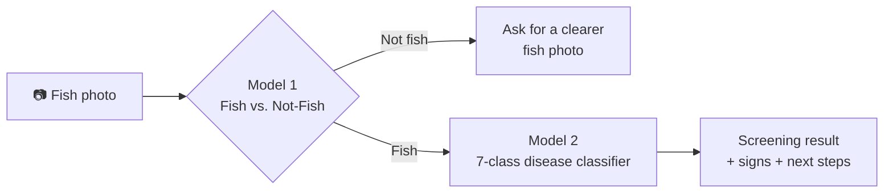

<div align="center">

# 🐟 AquaGuard AI – Fish Image Screening Models

**Two EfficientNetB0 models, trained in TensorFlow/Keras and converted to TensorFlow Lite, for offline fish-health screening on a phone.**


</div>

> ⚠️ **Important disclaimer**
> This project is for **preliminary screening only. It is not a veterinary diagnosis** and must not replace advice from a fish pathologist or aquaculture expert. All results below come from **public-dataset testing, not field trials**. Performance may vary with image quality, fish species, disease stage and environmental conditions.

---

## 📑 Table of contents

1. [Background](#-background)
2. [How it works](#-how-it-works)
3. [Results at a glance](#-results-at-a-glance)
4. [Model 1: Fish vs. Not-Fish](#-model-1-fish-vs-not-fish)
5. [Model 2: Fish Disease Classifier](#-model-2-fish-disease-classifier-7-classes)
6. [Datasets and licenses](#-datasets-and-licenses)
7. [Repository structure](#-repository-structure)
8. [Getting started](#-getting-started)
9. [Inference example](#-inference-example)
10. [TFLite conversion](#-tflite-conversion)
11. [Flutter integration notes](#-flutter-integration-notes)
12. [Known limitations](#-known-limitations)
13. [Roadmap](#-roadmap)
14. [Responsible use](#-responsible-use)
15. [Contributing and feedback](#-contributing-and-feedback)
16. [Acknowledgements](#-acknowledgements)
17. [License](#-license)

---

## 🌊 Background

Fish farmers in Bangladesh often notice a disease problem only after losses have already started. Survey evidence suggests many farmers struggle to identify disease from symptoms, and access to experts is limited.

**AquaGuard AI** is a Flutter app that gives farmers water-quality feedback, a Bangla AI assistant, pond records and **fish image screening**. This repository contains the **image-screening models** behind that last feature. They run **on-device**, so they work without an internet connection.

---

## 🔄 How it works



1. **Fish validation:** a binary classifier checks that the photo actually contains a fish.
2. **Disease classification:** if it does, a seven-class classifier predicts a screening category.
3. **Result:** the app shows the category with signs and suggested next steps, framed as screening, not diagnosis.

---

## 📊 Results at a glance

| Model | Task | Test images | Test accuracy |
|---|---|---:|---:|
| Model 1 | Fish vs. Not-Fish (binary) | 1,814 | ~99% |
| Model 2 | Fish disease (7 classes) | 772 | **98.70%** |

> **Read these numbers with caution.** They come from public datasets. The fish/not-fish score in particular likely overstates real-world performance, because flowers and low-resolution CIFAR-10 images are far easier negatives than real ponds, nets, hands and murky water. Per-class metrics for Model 2 are still to be added (see [Roadmap](#-roadmap)).

---

## 🔍 Model 1: Fish vs. Not-Fish

Screens each image before it reaches the disease classifier.

| Item | Detail |
|---|---|
| Architecture | EfficientNetB0, transfer learning |
| Task | Binary classification |
| Dataset size | 12,090 images |
| Class balance | 6,045 fish / 6,045 non-fish |
| Non-fish sources | TensorFlow Flowers (3,670), CIFAR-10 (2,375) |
| Test set | 1,814 images |
| Test accuracy | ~99% |

**Why a validator?** A seven-class softmax always picks a class, even for a flower or a hand. A fish check reduces nonsense outputs from irrelevant photos.

**Caveat:** the current negatives are easy. Planned hard negatives include hands, nets, buckets, empty ponds, murky water, prawns and other aquatic animals, dead fish and market fish.

---

## 🩺 Model 2: Fish Disease Classifier (7 classes)

### Classes

| # | Class |
|---|---|
| 1 | Bacterial Red Disease |
| 2 | Bacterial Diseases – Aeromoniasis |
| 3 | Bacterial Gill Disease |
| 4 | Fungal Disease – Saprolegniasis |
| 5 | Parasitic Diseases |
| 6 | Viral Disease – White Tail Disease |
| 7 | Healthy Fish |

> Class order above is for reading only. The actual index order must match the `class_names` used during training. See `labels/`.

### Data and preprocessing

| Item | Detail |
|---|---|
| Total images | 5,257 |
| Split | 3,690 train / 795 validation / 772 test |
| Input shape | 224 × 224 × 3 (RGB) |
| Imbalance handling | Class weighting |
| Augmentation | Horizontal flip, rotation, zoom, contrast, brightness |
| Label handling | Labels from several public sources were standardised into the seven classes above |

### Training recipe

| Stage | What was trained | Notes |
|---|---|---|
| **Stage 1** | New classification head | Backbone frozen |
| **Stage 2** | Last 80 layers of the backbone | Fine-tuned at a low learning rate |

Regularisation and control: dropout, early stopping, learning-rate reduction on plateau.

### Result

| Metric | Value |
|---|---:|
| Test accuracy (772 images) | **98.70%** |
| Per-class precision / recall / F1 | _TBD_ |
| Confusion matrix | _TBD_ |

<!-- Add confusion matrix image here, e.g.  -->

---

## 📚 Datasets and licenses

| Dataset | Used for | Link |
|---|---|---|
| MatsyaDx-BD | Fish disease images | https://lnkd.in/gHacX3-7 |
| Fish Disease Detection Dataset (irfanulhuda) | Fish disease images | https://lnkd.in/g895nKNQ |
| TensorFlow Flowers | Non-fish negatives (3,670) | https://lnkd.in/gnf9CQmJ |
| CIFAR-10 | Non-fish negatives (2,375) | https://lnkd.in/gTk-RSd9 |

Datasets are **not redistributed** in this repository. Please download them from the original sources and follow each dataset's license and terms of use.

---

## 🗂 Repository structure

> Adjust to match your actual folders.

```text
.
├── notebooks/
│   ├── 01_fish_not_fish_training.ipynb
│   ├── 02_fish_disease_training.ipynb
│   └── 03_tflite_conversion_and_eval.ipynb
├── models/
│   ├── fish_not_fish.keras
│   ├── fish_not_fish.tflite
│   ├── fish_disease.keras
│   └── fish_disease.tflite
├── labels/
│   ├── fish_not_fish_labels.txt
│   └── fish_disease_labels.txt
├── docs/                 # figures, confusion matrices, benchmarks
├── requirements.txt
└── README.md
```

---

## 🚀 Getting started

```bash
git clone https://github.com/<your-username>/<your-repo>.git
cd <your-repo>

python -m venv .venv
source .venv/bin/activate        # Windows: .venv\Scripts\activate
pip install -r requirements.txt
```

Suggested `requirements.txt`:

```text
tensorflow
numpy
pillow
scikit-learn
matplotlib
```

Training notebooks were developed for a GPU environment (for example Google Colab or Kaggle). Pin the exact TensorFlow version you used so results are reproducible.

---

## 🧪 Inference example

Two-stage pipeline using the TFLite models:

```python
import numpy as np
import tensorflow as tf
from PIL import Image

IMG_SIZE = (224, 224)
FISH_THRESHOLD = 0.5          # tune on hard negatives
CONFIDENCE_THRESHOLD = 0.60   # below this, report "uncertain"

DISEASE_LABELS = [l.strip() for l in open("labels/fish_disease_labels.txt")]


def load_interpreter(path):
    interp = tf.lite.Interpreter(model_path=path)
    interp.allocate_tensors()
    return interp


def run(interp, x):
    inp = interp.get_input_details()[0]
    out = interp.get_output_details()[0]
    interp.set_tensor(inp["index"], x)
    interp.invoke()
    return interp.get_tensor(out["index"])[0]


def preprocess(path):
    img = Image.open(path).convert("RGB").resize(IMG_SIZE)
    # Keras EfficientNet usually expects raw 0-255 pixels with rescaling
    # inside the model. Match exactly what you used in training.
    return np.expand_dims(np.array(img, dtype=np.float32), 0)


fish_check = load_interpreter("models/fish_not_fish.tflite")
disease = load_interpreter("models/fish_disease.tflite")

x = preprocess("fish.jpg")

# Stage 1: is it a fish?
# Confirm which output index means "fish" in YOUR training setup.
p_fish = float(run(fish_check, x)[0])
if p_fish < FISH_THRESHOLD:
    print("No fish detected. Please retake the photo.")
else:
    # Stage 2: screening category
    probs = run(disease, x)
    top = int(np.argmax(probs))
    if probs[top] < CONFIDENCE_THRESHOLD:
        print("Uncertain result. Please consult a fish health expert.")
    else:
        print(f"Screening result: {DISEASE_LABELS[top]} ({probs[top]:.1%})")
        print("This is a screening result, not a diagnosis.")
```

---

## 🔧 TFLite conversion

```python
import tensorflow as tf

model = tf.keras.models.load_model("models/fish_disease.keras")

converter = tf.lite.TFLiteConverter.from_keras_model(model)
# Optional: smaller and faster, but re-check accuracy after quantisation.
# converter.optimizations = [tf.lite.Optimize.DEFAULT]

tflite_model = converter.convert()
with open("models/fish_disease.tflite", "wb") as f:
    f.write(tflite_model)
```

### Benchmarks (to be filled in)

| Model | Format | Size | Latency (device) | Test accuracy |
|---|---|---:|---:|---:|
| Fish vs. Not-Fish | Keras | _TBD_ | n/a | ~99% |
| Fish vs. Not-Fish | TFLite | _TBD_ | _TBD_ | _TBD_ |
| Fish disease | Keras | _TBD_ | n/a | 98.70% |
| Fish disease | TFLite | _TBD_ | _TBD_ | _TBD_ |

Accuracy should be re-measured **after conversion**, ideally through the same preprocessing path the Flutter app uses.

---

## 📱 Flutter integration notes

- Load both `.tflite` files and the label files as app assets.
- Resize to 224 × 224 and keep RGB channel order.
- Use the **same pixel scaling as training**. A mismatch (for example 0–255 vs. 0–1) silently reduces accuracy.
- Show the confidence and an "uncertain, consult an expert" state instead of always forcing a class.
- Always show the screening disclaimer next to results and next-step advice.

---

## ⚠️ Known limitations

- **Public data only.** No field trials yet.
- **Closed-set classifier.** The seven-class model always picks a class, even for unseen diseases, other species or poor photos.
- **Visually similar conditions.** Bacterial, viral and parasitic conditions can look alike in photos and may not be separable from an image alone.
- **Easy negatives.** The fish check was trained against flowers and CIFAR-10, not realistic farm scenes.
- **Dataset bias.** Models may partly learn background, camera or dataset style rather than disease signs.
- **Species and stage.** Performance may differ across species and disease stages not well represented in the data.

---

## 🗺 Roadmap

- [ ] Per-class precision, recall, F1 and confusion matrix for the 7-class model
- [ ] Duplicate and near-duplicate check across train/validation/test splits
- [ ] Realistic hard negatives for the fish check
- [ ] Confidence threshold with an "uncertain, consult an expert" outcome
- [ ] TFLite size, latency and post-conversion accuracy benchmarks
- [ ] Expert review of class definitions and next-step advice
- [ ] Field testing with farmers

---

## 🤝 Responsible use

- Treat outputs as **screening hints**, not diagnoses.
- Do not make treatment or medication decisions from the app output alone.
- Confirm suspected outbreaks with a qualified fish health professional or local fisheries office.

---

## 💬 Contributing and feedback

Feedback is especially welcome from **fish pathologists, aquaculture specialists and ML engineers**.

- 🐛 Found a problem or a mislabelled class? Open an issue.
- 💡 Have a suggestion (hard negatives, evaluation ideas, domain corrections)? Open a discussion or pull request.

---

## 🙏 Acknowledgements

- Authors and maintainers of MatsyaDx-BD and the Fish Disease Detection Dataset
- TensorFlow Flowers and CIFAR-10 dataset teams
- TensorFlow, Keras and TensorFlow Lite communities

---

## 📄 License

Add your chosen license here (for example MIT or Apache-2.0) and keep dataset licenses separate. Model weights trained on third-party data may inherit usage restrictions from those datasets.
